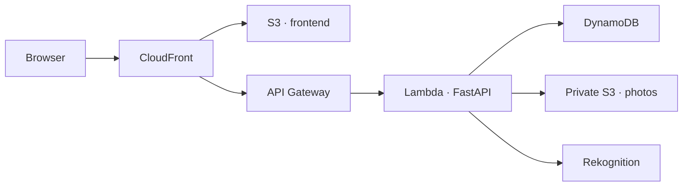

# WasteLens

A cleanliness community app for Lucknow. Take a photo of unmanaged waste, confirm
its location, and create a report that neighbors can discuss and support.

Built by TeamLuna for the **WeMakeDevs × AWS Environmental Hacks** hackathon,
under the Waste and Energy track.

**[Open WasteLens](https://d29b1yfg6ycbnb.cloudfront.net/)** ·
[API contract](docs/api-contract.md) ·
[AWS verification](docs/aws-integration-verification.md)

## What you can do

- **Report a waste site.** Upload an image or take a photo directly, then review
  the photo and location before filing. Camera capture includes preview and retake.
- **Discuss the report.** Share the photo publicly if you choose, add comments,
  and support an existing report instead of filing another one.
- **Start a community.** Register a local group with its area and purpose.
- **Get waste guidance.** Review image suggestions or choose a category manually
  to find sourced handling advice. The field guide helps with reporting, municipal
  contacts and community next steps.
- **Find nearby bins.** Search OpenStreetMap's community-mapped litter bins and
  recycling containers using device coordinates or a point you choose on the map.
- **Prepare a complaint.** Edit a structured draft using the report's details and
  Lucknow Nagar Nigam's published contact information.

Email/password accounts are available. Guests can also report and participate.
Google sign-in is prepared for future development and is currently disabled.

## Reporting flow

1. Take or select a photo.
2. Confirm the waste site's location. Device location includes its accuracy radius;
   the address and coordinates can be corrected manually.
3. Save the report and receive its ID.
4. Review optional image analysis and edit the complaint draft.
5. Share the report with neighbors, comment and support a next step.

A report remains saved if analysis or a board refresh fails. Upload retries reuse
its ID, and failed optional steps can be retried from the saved report.

The pilot covers an approximate Lucknow area. It does not determine ward
jurisdiction, and residents must confirm whether a site is within LNN's remit.

## AWS deployment

The public pilot runs in **Sydney (`ap-southeast-2`)**.



| Service | Use in WasteLens | Current status |
| --- | --- | --- |
| CloudFront + S3 | HTTPS frontend | Deployed |
| API Gateway + Lambda | FastAPI backend | Deployed |
| DynamoDB | Reports, discussions, communities and account sessions | Persistence verified |
| Private S3 | Photo upload, normalization and opt-in sharing | Upload and confirmation verified |
| Rekognition | Image labels and moderation signals | Real calls verified with a synthetic image |
| Bedrock + Strands | Optional photo classification and bounded help-topic planning | Implemented; inference blocked by account quotas |
| Secrets Manager | Operator credential | Configured and verified |
| CloudWatch | Backend logs | Configured |
| SES | Owner-approved complaint email | Disabled; sender/delivery setup remains |

On **10 October 2026**, a fresh Nova Lite request returned HTTP 429,
`ThrottlingException`. Model availability and authorization checks passed, but the
account's daily-token and on-demand request/token quotas were zero. The deployed
app keeps Bedrock disabled and uses local pilot guidance, with Rekognition
suggestions and manual correction available for photos.

Real cloud upload and persistence checks used a clearly labelled synthetic report.
They establish infrastructure behavior, not classification accuracy or a completed
cleanup. See the [verification log](docs/aws-integration-verification.md) for details.

## Run locally

Requirements: **Python 3.13** and **Node.js 22**. AWS credentials are optional for
local development; SQLite stores local reports and manual assessment remains usable.

Backend:

```sh
cd backend
python3.13 -m venv .venv
source .venv/bin/activate
python -m pip install -r requirements-lock.txt
uvicorn app.main:app --reload --host 127.0.0.1 --port 8000
```

Frontend, in another terminal:

```sh
cd frontend
npm ci
npm run dev -- --host 127.0.0.1 --port 5173 --strictPort
```

Open [localhost](http://127.0.0.1:5173/).
FastAPI's interactive docs are at [localhost:8000/docs](http://127.0.0.1:8000/docs).
Run Vite to serve the app; opening `frontend/index.html` directly will not work.

Local databases and uploaded photos are excluded from Git. `.env.example` documents
optional settings; copy configuration into your process environment or load a local
file explicitly with Uvicorn's `--env-file` option. Keep credentials out of that file
and use a temporary AWS profile for cloud access.

### Development checks

```sh
cd backend
.venv/bin/python -m unittest discover -s tests -v
```

```sh
cd frontend
npm test
npm run build
```

GitHub Actions runs the backend suite, frontend tests and production build on pushes
and pull requests. Existing regressions cover upload confirmation and retries,
cloud filtering, saved-report recovery, geolocation, account sessions and moderation.
Mocked AWS tests are separate from verified live requests.

## Privacy and safety

- Exact locations and complaint drafts are private. Public map pins are rounded.
- Photos stay private until the reporter opts into sharing. Sharing can be revoked,
  although copies already downloaded by others cannot be recalled.
- Uploads are validated, resized and normalized to JPEG without EXIF metadata.
- Account sessions use HttpOnly cookies; passwords use salted scrypt hashes.
- Guest report-editing permissions stay with the browser used to create the report.
- Complaint delivery requires separate owner approval. An accepted email would not
  guarantee an LNN acknowledgment or ticket. No municipal email has been sent in testing.
- Quantities, cleanup costs and environmental impact are estimates when provided;
  the app does not present them as measured outcomes.

## Current limits

- Email verification, password recovery and cross-device guest-report ownership
  are not implemented. Google sign-in remains disabled.
- Community registration creates a directory entry. Group membership and group
  chat are future work; discussions currently belong to reports.
- Overpass data can be incomplete or outdated. Nearby bins are not a verified
  municipal inventory, and local recycler/collection acceptance may be unverified.
- Physical phone-camera capture still needs a device check.
- The daily AI-operation allowance limits app usage, not total AWS spending.

## Project layout

```text
frontend/          React, Vite, styles and browser workflows
backend/app/       FastAPI routes, storage, accounts and AWS integrations
backend/data/      Public pilot directory and guidance sources
backend/tests/     Backend regression tests
frontend/tests/    Frontend workflow tests
backend/scripts/   AWS audit and safe Lambda packaging
docs/              API, deployment, verification and demo notes
template.yaml      AWS SAM infrastructure
```

## Documentation

- [AWS deployment](docs/deployment-aws.md)
- [Live AWS verification](docs/aws-integration-verification.md)
- [API contract](docs/api-contract.md)
- [Architecture](docs/architecture.md)
- [Demo walkthrough](docs/demo-script.md)
- [Future Google sign-in setup](docs/google-signin.md)

## Credits and license

Built with React, Vite, FastAPI, Leaflet, OpenStreetMap and the AWS SDKs. Map data
© [OpenStreetMap contributors](https://www.openstreetmap.org/copyright);
nearby-bin lookup uses [Overpass](https://wiki.openstreetmap.org/wiki/Overpass_API).
Waste guidance references are recorded in the pilot data files. Illustrative
food-waste impact estimates reference EPA WARM assumptions.

OpenAI Codex was used for implementation and debugging. Source code is available
under the [MIT license](LICENSE).
