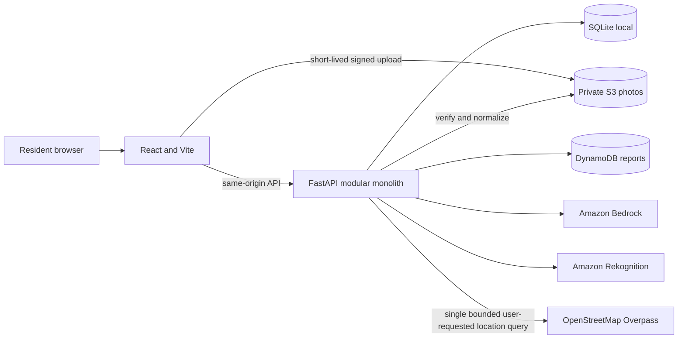

# WasteLens architecture

Local mode uses SQLite and local files. Cloud mode selects DynamoDB and S3 through environment settings. The API contract is the seam between these modes; AWS-specific storage is behind a small adapter, not a separate service.

## Data boundaries

- Public board reads omit exact addresses and complaint drafts, and round coordinates to two decimal places. An opted-in photo exposes only the report photo API URL; storage keys and private photos remain hidden.
- The reporter's random bearer token is issued once and only its hash is stored. The browser keeps it in session storage for owner edits and deletion.
- The public map receives only rounded coordinates.
- The personal waste guide does not save photos to WasteLens report storage; Bedrock vision receives an image only after the user requests an analysis.
- Nearby-bin coordinates are sent to Overpass only after an explicit browser-location action, are restricted to the approximate Lucknow pilot, and are not saved in WasteLens storage.
- A report remains private and pending until its photo is verified and normalized.
- Only status changes use an operator credential; local changes append an audit event, while cloud changes use a conditional DynamoDB transaction.
- Support votes are unique per report and hashed client token. Cloud support count and the unique marker are committed atomically.
- Assistant model calls do not include report content or location. Visible factual answers are assembled from allowlisted local data.

See [AWS deployment](deployment-aws.md) for the cloud controls and [API contract](api-contract.md) for endpoint shapes.
